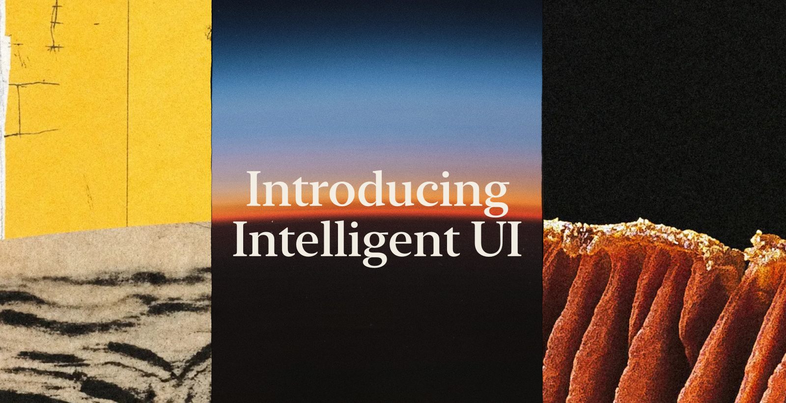

# Intelligent UI for Claude Code

**Claude's answers, rendered.** Real Markdown, math, charts and diagrams, right in your terminal.

<sub>An independent, community-made mod for Claude Code. Not affiliated with Anthropic.</sub>

Intelligent UI draws each answer from Claude as a typeset picture, with [Typst](https://typst.app). Tables line up, equations look like a paper, and Claude can draw a chart or a diagram when a picture explains more than words. Only the drawing changes. The saved answer stays Markdown.

## Install

```
brew install typst
```

Then, in Claude Code:

```
/plugin install cc-intelligent-ui --marketplace razorback16/cc-intelligent-ui
```

It works at once, with no restart.

You need Claude Code 2.1.298 or later, [Typst](https://typst.app) 0.15 and macOS. The pictures show only in some terminals:

| Terminal | Pictures | What to do |
|---|---|---|
| kitty 0.28+, Ghostty, cmux | Yes | Nothing |
| iTerm2 3.6+ | Yes | Run `/iui setup` one time |
| Rio 0.5.27+ | Yes (not tested) | Set `CLAUDE_CODE_FORCE_TERMINAL_IMAGES=1` |
| ssh | Yes, from kitty or Ghostty | Refer to [Install](docs/install.md#terminals) |
| tmux, screen | No | — |
| WezTerm, Warp, Konsole, Terminal.app, Alacritty, VS Code, Windows Terminal, GNOME Terminal, others | No | — |

In other terminals, the mod shows the normal text. Refer to [Install](docs/install.md#terminals) for all the details, and run `/iui details` to see why pictures do or do not show.


## Why

- **Rendered Markdown.** Headings, tables, task lists, block quotes and code with syntax colours, in your terminal's own font.
- **LaTeX math.** Inline `$…$` and display `$$…$$` math, typeset.
- **Live diagrams, charts and plots.** Claude writes Typst with CeTZ, cetz-plot and fletcher. The drawings use your theme's colours and work offline.
- **Images and files.** Images in an answer, images that Claude sends, Markdown files that Claude sends, and images that you paste show in the transcript.
- **Copy text from pictures.** Select and copy text with the mouse, as you do with normal text.
- **Links you can click.** The links, file paths and commands of an answer show in rows under its picture. A cmd+click on a link opens it. A click on a command copies it.
- **Plans you can read.** In plan mode, the plan shows rendered, with an approve, edit or reject question under it.
- **Themes that follow light and dark.** Claude Code's own colours by default, or VS Code's Markdown preview. You can make your own.

## See it

<table>
  <tr>
    <td width="50%">
      <picture>
        <source media="(prefers-color-scheme: dark)" srcset="outcomes/out/6-diagrams-dark.png">
        <source media="(prefers-color-scheme: light)" srcset="outcomes/out/6-diagrams-light.png">
        
      </picture>
    </td>
    <td width="50%">
      <picture>
        <source media="(prefers-color-scheme: dark)" srcset="outcomes/out/2-math-dark.png">
        <source media="(prefers-color-scheme: light)" srcset="outcomes/out/2-math-light.png">
        
      </picture>
    </td>
  </tr>
</table>

More in the [gallery](docs/gallery.md): plots, fractals and a tour of all the Markdown.

## Commands

| Command | What it does |
|---|---|
| `/iui` | Shows the state and a problem that keeps pictures away |
| `/iui on` / `off` | Turns the pictures on or off |
| `/iui theme <name>` | Changes the theme: `claude-code`, `vscode-modern`, `vscode` or your own |
| `/iui size <80–200>` | Text size in percent of your terminal text |
| `/iui details` | Shows the terminal, font, mode and Typst that the mod found |
| `/iui setup` | iTerm2: adds the shell line that turns pictures on |
| `/iui grab` | Copies the text under your last mouse selection of pictures |
| `/iui dump` | Shows how the mod read the last clipboard with picture cells (for a bug report) |

All commands are in [Usage](docs/usage.md).

## Docs

- [Install](docs/install.md): requirements and terminal support
- [Usage](docs/usage.md): what it draws, commands, copy, plan approval
- [Themes](docs/themes.md): built-in themes and your own
- [How it works](docs/how-it-works.md): the render steps and light or dark mode
- [Limitations](docs/limitations.md): copy, search, timing and other limits
- [Development](docs/development.md): build, test and module layout
- [Gallery](docs/gallery.md): all the sample answers

## Disclaimer

Intelligent UI is an independent project. It is not made, supported or endorsed by Anthropic. Claude and Claude Code are trademarks of Anthropic, PBC.

## Licence

MIT, see [`LICENSE`](LICENSE). The vendored Typst packages and the VS Code theme values keep their own licences: see [`THIRD-PARTY-NOTICES.md`](THIRD-PARTY-NOTICES.md).
