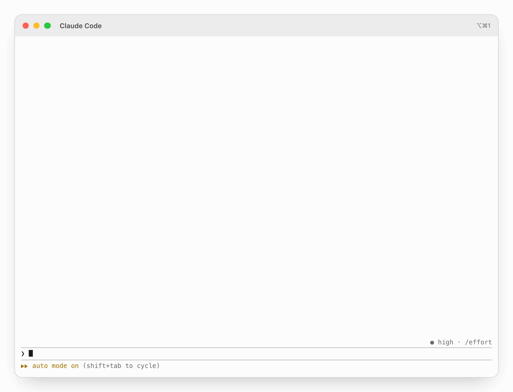

<picture>
  <source media="(prefers-color-scheme: dark)" srcset="outcomes/out/hero-dark.gif">
  <source media="(prefers-color-scheme: light)" srcset="outcomes/out/hero-light.gif">
  
</picture>

# Intelligent UI for Claude Code

**Claude's answers, rendered.** Real Markdown, math, charts and diagrams, right in your terminal.

<sub>An independent, community-made mod for Claude Code. Not affiliated with Anthropic.</sub>

Intelligent UI draws each answer from Claude as a typeset picture, with [Typst](https://typst.app). Tables line up, equations look like a paper, and Claude can draw a chart or a diagram when a picture explains more than words. Only the drawing changes. The saved answer stays Markdown.

## Install

In a shell, on macOS or Linux:

```
curl -fsSL https://intelligentui.art/install.sh | bash
```

Then restart Claude Code, or type `/reload-plugins` in a session. To update, run the command again. You can [read the script](site/install.sh) before you run it.

What `install.sh` does:

1. It checks that the system is macOS or Linux (arm64 or x86_64) and that Claude Code is installed. If Claude Code is not installed, it stops and changes nothing.
2. If it finds no Typst 0.15 or later, it downloads the official Typst 0.15.1 release from GitHub, checks its SHA-256 (written in the script), and puts `typst` in `~/.local/bin`. It never uses `sudo`.
3. It adds the `razorback16` marketplace and installs the mod with the `claude plugin` commands. If they are installed, it updates them. If your `razorback16` marketplace comes from another source (a fork, a pinned ref or a local folder), an update can not get the newest version: the script removes that marketplace, adds it again from GitHub and installs the mod again (a disabled mod stays disabled). It uninstalls a second user copy of the mod from another marketplace, and only shows copies in a project. It tells you each change and how to undo it.
4. It turns on auto-update for the `razorback16` marketplace: `"autoUpdate": true` for `razorback16` in `extraKnownMarketplaces` of `~/.claude/settings.json`. It keeps all other settings and keeps the file before this change as `settings.json.bak-iui` (step 3 changed the file already; the backup undoes only the auto-update change). If the file is not valid JSON, the script does not change it and shows the lines to add.
5. If iTerm2 or herdr is there, it adds the mod's own `/iui setup` block to the start file of your login shell (`~/.zshrc`, `~/.bash_profile` on macOS, `~/.bashrc` on Linux, or a fish `conf.d` file), with a backup `<file>.bak-iui`. The block sets `CLAUDE_CODE_FORCE_TERMINAL_IMAGES=1` in iTerm2 and herdr only. Undo: `/iui setup remove` in Claude Code.

`IUI_NO_TYPST=1` skips step 2, `IUI_NO_AUTO_UPDATE=1` skips step 4, and `IUI_NO_SHELL_SETUP=1` skips step 5, for example `curl -fsSL https://intelligentui.art/install.sh | IUI_NO_AUTO_UPDATE=1 bash`.

To undo: `claude plugin uninstall cc-intelligent-ui@razorback16`, then `claude plugin marketplace remove razorback16` (this also removes its entry in `settings.json`). If the script installed Typst: `rm ~/.local/bin/typst`. Refer to [The install script](docs/install.md#the-install-script).

### Install by hand

```
brew install typst
```

On Linux, you can also use `cargo install --locked typst-cli`, a package of your distribution, or the release file from GitHub. Refer to [Install](docs/install.md#install-typst-on-linux).

Then, in Claude Code:

```
/plugin install cc-intelligent-ui --marketplace razorback16/cc-intelligent-ui
```

It works at once, with no restart.

### Fullscreen, updates and terminals

Intelligent UI works best in fullscreen mode (recommended). To use it, run `/tui fullscreen` in Claude Code.

To get new versions, turn on auto-update for the `razorback16` marketplace in `/plugin` (the install script does this for you), or update manually. Refer to [Update](docs/install.md#update). The mod also shows a notice when a new version is available (`/iui updates off` stops it).

You need Claude Code 2.1.298 or later, [Typst](https://typst.app) 0.15, and macOS or Linux (X11 or Wayland). The pictures show only in some terminals:

| Terminal | Pictures | What to do |
|---|---|---|
| kitty 0.28+, Ghostty, cmux (macOS) | Yes | Nothing |
| iTerm2 3.6+ (macOS) | Yes | Run `/iui setup` one time |
| herdr, in kitty, Ghostty or iTerm2 | Yes | Run `/iui setup` one time |
| Rio 0.5.27+ | Yes (not tested) | Set `CLAUDE_CODE_FORCE_TERMINAL_IMAGES=1` |
| ssh | Yes, from kitty or Ghostty | Refer to [Install](docs/install.md#terminals) |
| tmux, screen | No | — |
| Warp | Not yet | Support comes when [warpdotdev/warp#16312](https://github.com/warpdotdev/warp/pull/16312) is merged |
| WezTerm | Not yet | Support comes when [wezterm/wezterm#7924](https://github.com/wezterm/wezterm/pull/7924) is merged |
| Konsole, Terminal.app, Alacritty, VS Code, Windows Terminal, GNOME Terminal, others | No | — |

In other terminals, the mod shows the normal text. Refer to [Install](docs/install.md#terminals) for all the details, and run `/iui details` to see why pictures do or do not show.


## Why

- **Rendered Markdown.** Headings, tables, task lists, block quotes and code with syntax colours, in your terminal's own font.
- **LaTeX math.** Inline `$…$` and display `$$…$$` math, typeset.
- **Live diagrams, charts and plots.** Claude writes Typst with CeTZ, cetz-plot and fletcher. The drawings use your theme's colours and work offline. For a complex drawing, Claude loads the bundled `intelligent-ui` skill, with the full API and a compile check.
- **Images and files.** Images in an answer, images that Claude sends, Markdown files that Claude sends, and images that you paste show in the transcript. Images that you paste also show above the prompt box before you send. Refer to [Preview of pasted images](docs/usage.md#preview-of-pasted-images).
- **Copy text from pictures.** In fullscreen mode, drag over a picture with the mouse, as you do over normal text. The mod highlights the selected text and copies it when you release the button. Refer to [Copy text from a picture](docs/usage.md#copy-text-from-a-picture).
- **Links you can click.** The links, file paths and commands of an answer show in rows under its picture. A cmd+click on a link opens it. A click on a command copies it.
- **Plans you can read.** In plan mode, the plan shows rendered, with an approve, edit or reject question under it.
- **Themes that follow light and dark.** Claude Code's own colours by default, or VS Code's Markdown preview. You can make your own.

## See it

<table>
  <tr>
    <td width="50%">
      <picture>
        <source media="(prefers-color-scheme: dark)" srcset="outcomes/out/6-diagrams-dark.png">
        <source media="(prefers-color-scheme: light)" srcset="outcomes/out/6-diagrams-light.png">
        
      </picture>
    </td>
    <td width="50%">
      <picture>
        <source media="(prefers-color-scheme: dark)" srcset="outcomes/out/2-math-dark.png">
        <source media="(prefers-color-scheme: light)" srcset="outcomes/out/2-math-light.png">
        
      </picture>
    </td>
  </tr>
</table>

More in the [gallery](docs/gallery.md): plots, fractals and a tour of all the Markdown.

## Commands

| Command | What it does |
|---|---|
| `/iui` | Shows the state and a problem that keeps pictures away |
| `/iui on` / `off` | Turns the pictures on or off |
| `/iui theme <name>` | Changes the theme: `claude-code`, `vscode-modern`, `vscode` or your own |
| `/iui size <80–200>` | Text size in percent of your terminal text |
| `/iui grid on` / `off` | Puts each line of text on the terminal rows, so that a mouse selection covers the text (on by default) |
| `/iui select on` / `off` | Claude Code 2.1.298+, fullscreen: the mod selects and copies picture text with the mouse (on by default) |
| `/iui updates on` / `off` | Turns the daily check for a new version on or off (on by default) |
| `/iui details` | Shows the terminal, font, mode and Typst that the mod found |
| `/iui setup` | iTerm2 (macOS) and herdr: adds the shell line that turns pictures on |
| `/iui grab` | Copies the text under your last mouse selection of pictures |
| `/iui dump` | Shows how the mod read the last clipboard with picture cells (for a bug report) |

All commands are in [Usage](docs/usage.md).

## Privacy and access

The mod sends nothing about you or your sessions anywhere.

- **Network:** one GET request each day at most, to `raw.githubusercontent.com`, for the public `plugin.json` of this mod. It only tells you about a new version. `/iui updates off` stops it. It also stops when `CLAUDE_CODE_DISABLE_NONESSENTIAL_TRAFFIC`, `DISABLE_UPDATES` or `DISABLE_AUTOUPDATER` is set.
- **Clipboard, read:** a small `perl` process watches the clipboard while the mod is on and has drawn a picture (not over ssh). On macOS it reads only the change counter; when the counter changes, the mod reads the text once with a short `perl` script (PerlObjCBridge). On Linux a notifier (`wl-paste --watch`, `clipnotify` or GTK 3 from `python3`) tells it of each change, and it then reads the text with `wl-paste`, `xclip` or GTK. `/iui grab` with no mouse selection also reads the clipboard once. The text is only checked for picture cells (then a toast names `/iui grab`); it is kept in memory only and sent nowhere (`/iui dump` writes the last clipboard with picture cells to `copy-debug.json` in the cache folder). A password manager's copy is never read: on macOS a copy with a concealed or transient type, on Linux a copy that offers the `x-kde-passwordManagerHint` target, and on Wayland also a copy marked sensitive. (On Wayland, `wl-paste --watch` hands each new copy to `cat`, which drops it.)
- **Clipboard, written:** only at these times: when you release a picture selection, when you click a link, a file path, a command or a copy button in a picture, on `/iui grab`, when you press the command button in a link row (in fullscreen with `/iui select off`, where Claude Code gets the click), and when the mod changes a `$.ui.copy` that has picture cells to its text.
- **Files:** a private cache folder in `$TMPDIR` (`cc-intelligent-ui-<uid>`, `/tmp` when `TMPDIR` is not set; mode 700, its folders deleted after 2 days). Each compile makes a folder of its own in it (the Typst root, see below) and deletes it after the compile. Also `~/.cache/cc-intelligent-ui/designs` (files deleted after 180 days) and `~/.cache/cc-intelligent-ui/fonts` (fonts copied out of a terminal app, such as Ghostty's JetBrains Mono; `$XDG_CACHE_HOME` in place of `~/.cache` when it is set). The previews of pasted images are made in the cache folder too, from the image files that Claude Code writes when you paste. `/iui setup` (iTerm2 on macOS, and herdr) changes your shell start file, only when you run it or agree to its question. The install script adds the same block when iTerm2 or herdr is there (`IUI_NO_SHELL_SETUP=1` stops it).
- **Processes:** `typst`, the `perl` watcher, and short helper commands such as `perl`, `sh`, `osascript`, `defaults`, `plutil`, `fc-list` and `fc-match`. In herdr, while the mod is on and pictures show, a check each second finds the herdr client that you use: `stat` of the terminals' devices (the time of the last key), and on macOS `lsappinfo` (the app in front); each 10 s also `ps` (the processes and, of your own herdr clients, their variables) and `lsof`. Of a client's variables, the mod keeps only those of the terminal (for example `TERM`, `ITERM_PROFILE`, `GHOSTTY_RESOURCES_DIR`); it writes none of this anywhere. On Linux also `wl-paste`, `xclip`, `clipnotify` or `python3 -I` (GTK 3; isolated, so it loads no code from the project folder) for the clipboard.
- **Typst:** each compile of an answer or a plan runs with a narrow root: a new folder with the mod's template, the theme and the images that the text names. So the code in an answer cannot read other files on your computer. The skill's `check.sh` compiles the same way, and so does the preview of a pasted image (a folder with only its template and the pasted image).

## Docs

- [Install](docs/install.md): requirements, terminal support and updates
- [Usage](docs/usage.md): what it draws, the skill, commands, copy, plan approval
- [Themes](docs/themes.md): built-in themes and your own
- [How it works](docs/how-it-works.md): the render steps and light or dark mode
- [Limitations](docs/limitations.md): copy, search, timing and other limits
- [Development](docs/development.md): build, test and module layout
- [Gallery](docs/gallery.md): all the sample answers
- [Changelog](CHANGELOG.md): what changed in each release

## Disclaimer

Intelligent UI is an independent project. It is not made, supported or endorsed by Anthropic. Claude and Claude Code are trademarks of Anthropic, PBC.

## Licence

MIT, see [`LICENSE`](LICENSE). The vendored Typst packages and the VS Code theme values keep their own licences: see [`THIRD-PARTY-NOTICES.md`](THIRD-PARTY-NOTICES.md).
