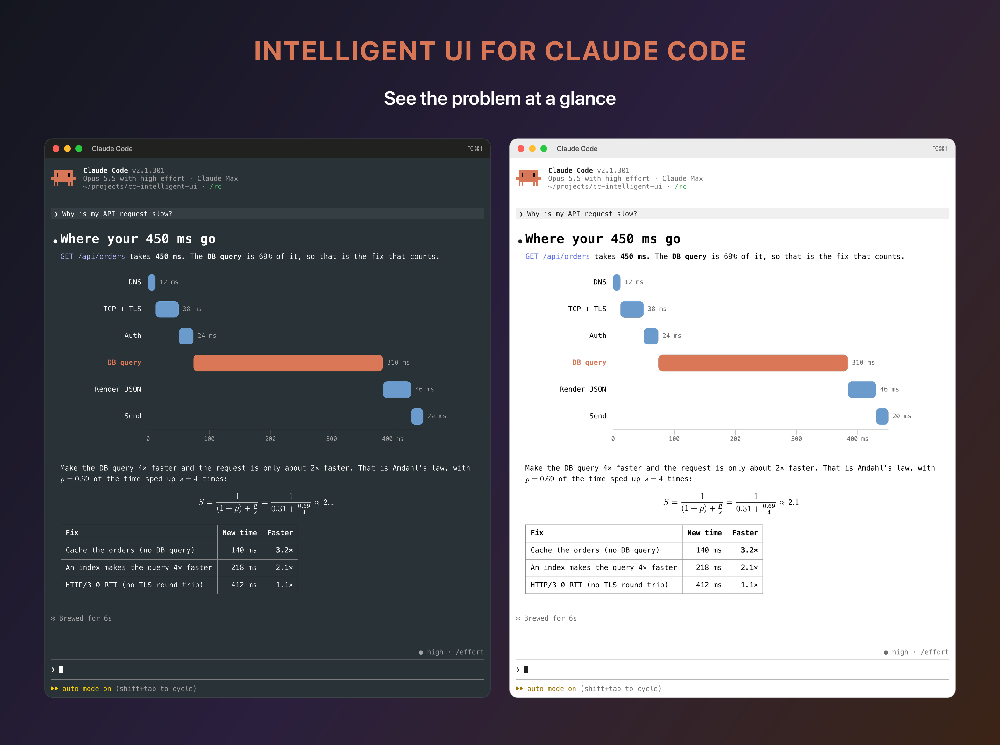
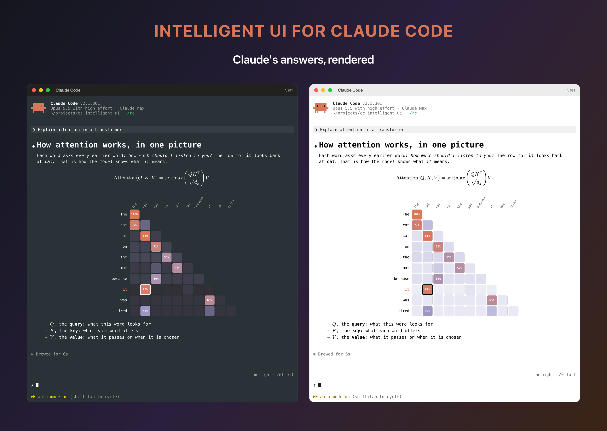
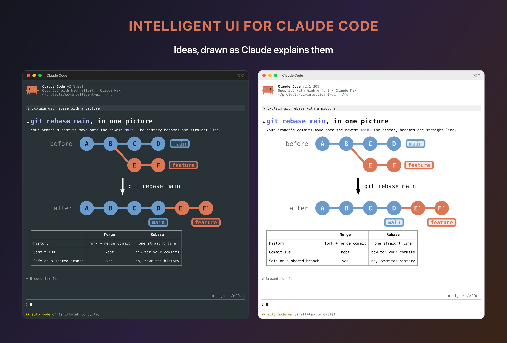
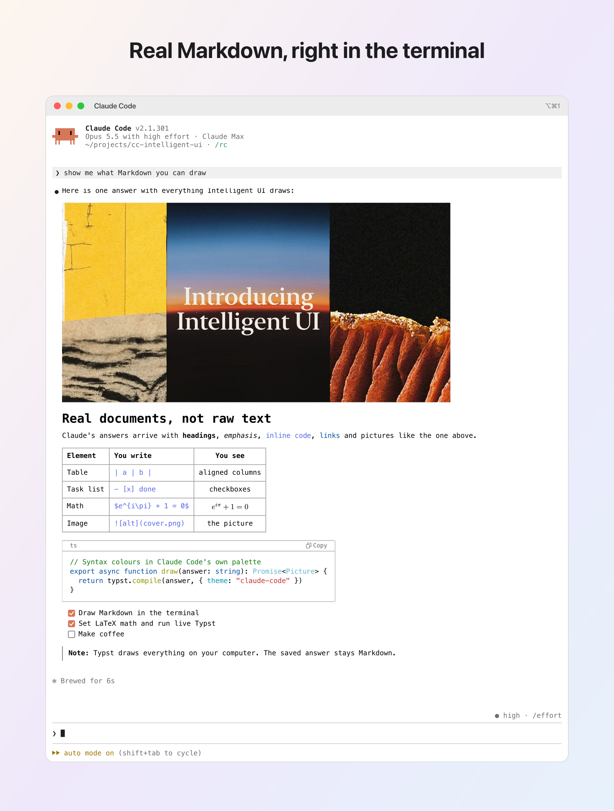
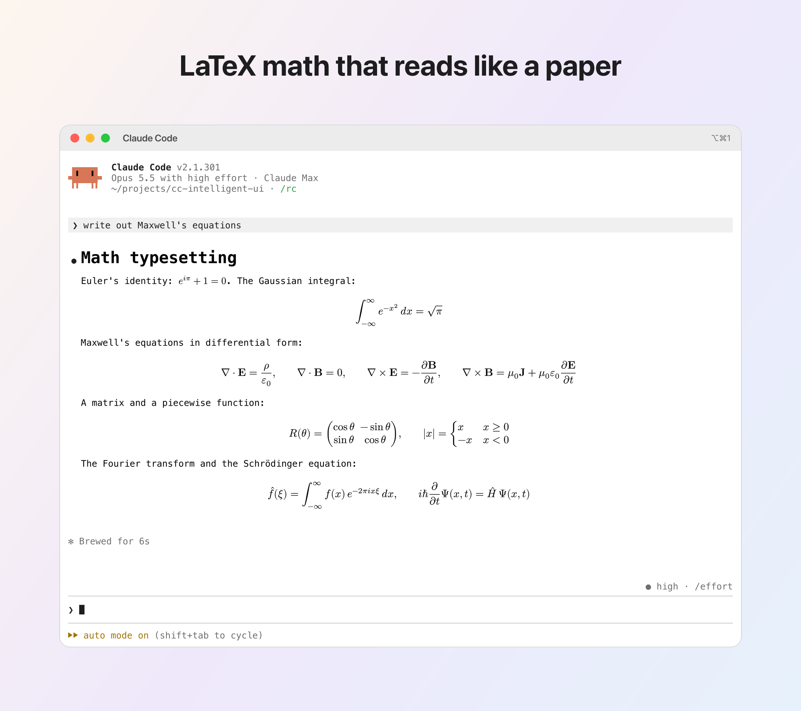
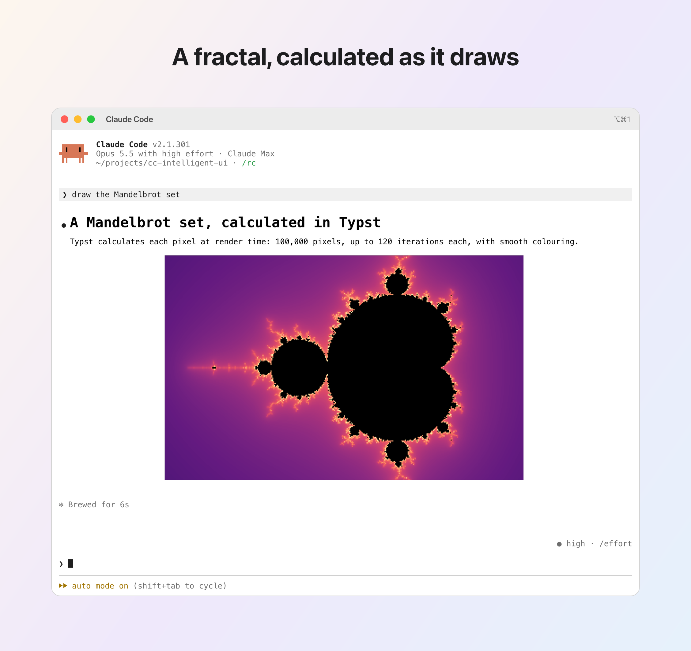
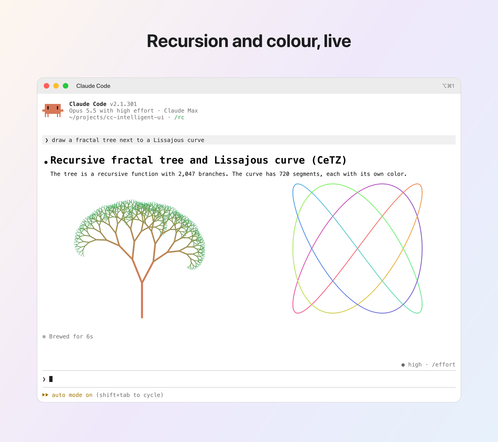
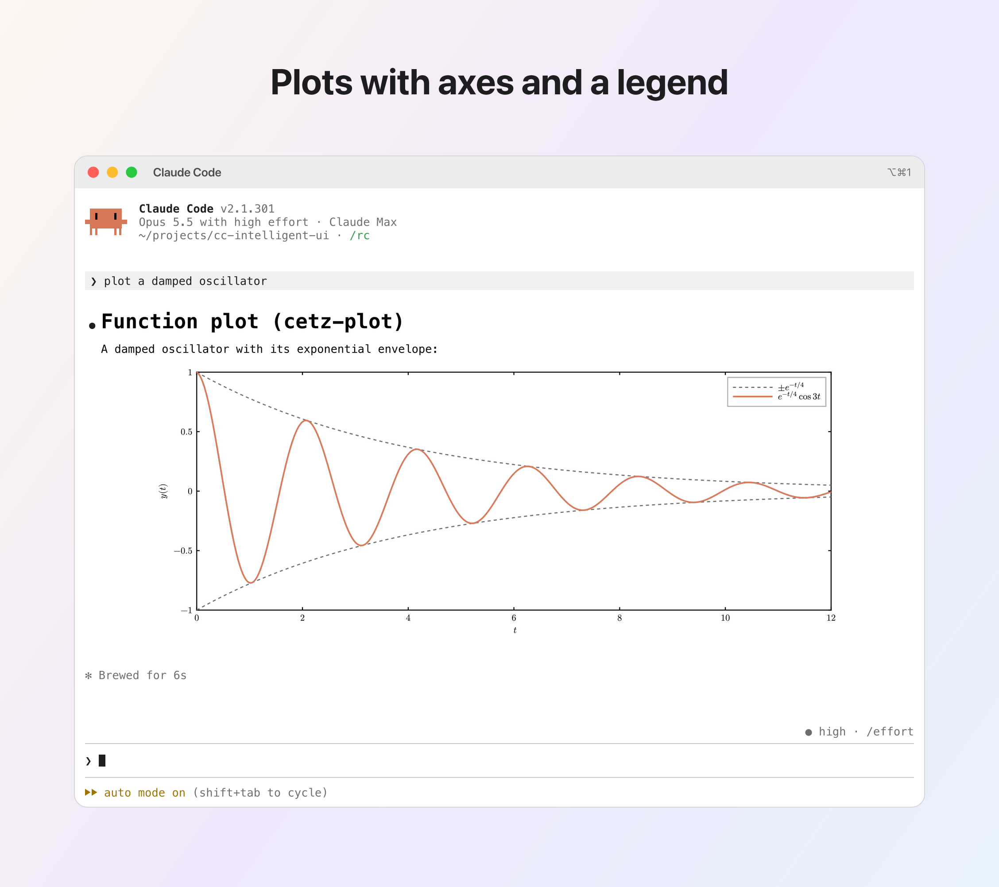
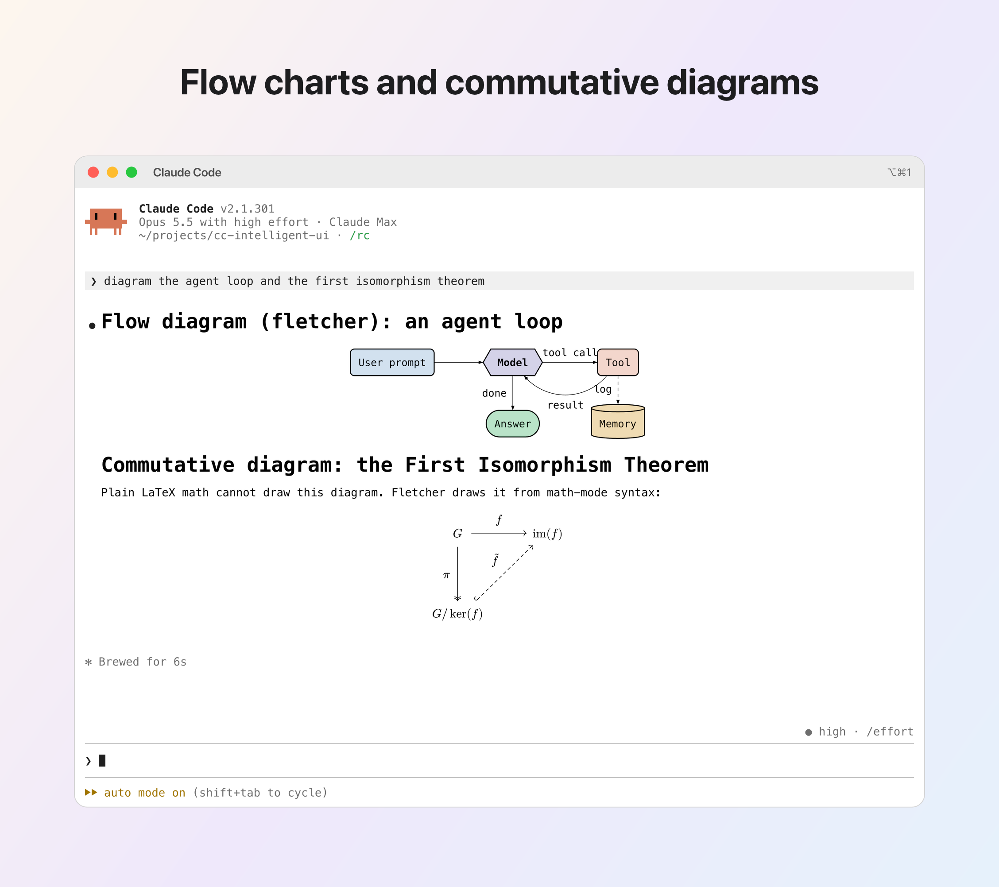

# Gallery

← Back to the [README](../README.md)

Real answers, drawn by Intelligent UI in Claude Code. The framed images follow your GitHub theme: you see the dark terminal in dark mode and the light terminal in light mode. The sources of the answers are in [`outcomes/samples/`](../outcomes/samples/).

## In a dark and a light terminal

## Real Markdown, right in the terminal

Headings, an image, a table, inline math, a code block with syntax colours, a task list and a block quote.

<picture>
  <source media="(prefers-color-scheme: dark)" srcset="../outcomes/out/1-overview-dark.png">
  <source media="(prefers-color-scheme: light)" srcset="../outcomes/out/1-overview-light.png">
  
</picture>

## LaTeX math that reads like a paper

Euler's identity, the Gaussian integral, Maxwell's equations, a matrix, a piecewise function, the Fourier transform and the Schrödinger equation.

<picture>
  <source media="(prefers-color-scheme: dark)" srcset="../outcomes/out/2-math-dark.png">
  <source media="(prefers-color-scheme: light)" srcset="../outcomes/out/2-math-light.png">
  
</picture>

## A fractal, calculated as it draws

Typst calculates each pixel of the Mandelbrot set at render time.

<picture>
  <source media="(prefers-color-scheme: dark)" srcset="../outcomes/out/3-mandelbrot-dark.png">
  <source media="(prefers-color-scheme: light)" srcset="../outcomes/out/3-mandelbrot-light.png">
  
</picture>

## Recursion and colour, live

A recursive fractal tree and a Lissajous curve, drawn with CeTZ.

<picture>
  <source media="(prefers-color-scheme: dark)" srcset="../outcomes/out/4-fractal-dark.png">
  <source media="(prefers-color-scheme: light)" srcset="../outcomes/out/4-fractal-light.png">
  
</picture>

## Plots with axes and a legend

A damped oscillator and its exponential envelope, drawn with cetz-plot.

<picture>
  <source media="(prefers-color-scheme: dark)" srcset="../outcomes/out/5-plot-dark.png">
  <source media="(prefers-color-scheme: light)" srcset="../outcomes/out/5-plot-light.png">
  
</picture>

## Flow charts and commutative diagrams

An agent loop and the First Isomorphism Theorem, drawn with fletcher.

<picture>
  <source media="(prefers-color-scheme: dark)" srcset="../outcomes/out/6-diagrams-dark.png">
  <source media="(prefers-color-scheme: light)" srcset="../outcomes/out/6-diagrams-light.png">
  
</picture>
